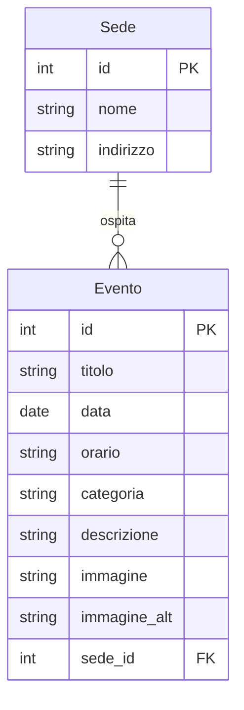

1. Entità: Evento e Sede.
2. Campi di ciascuna entità, con tipo ed esempio: sono quelli dei due JSON che hai completato.
3. Chiave primaria di ciascuna entità: `id` numerico, univoco nell’entità e stabile.
4. Relazione: una sede può ospitare più eventi; ogni evento si svolge in una sede. `Evento.sede_id` fa riferimento a `Sede.id`.
5. Quantità: sei eventi e tre sedi.
6. Chi aggiorna i dati e come: modifica dei file nella repository e pubblicazione.
7. Che cosa mostra la pagina.

Una sede può ospitare più eventi; ogni evento si svolge in una sola sede, identificata da `Evento.sede_id`, che fa riferimento a `Sede.id`.